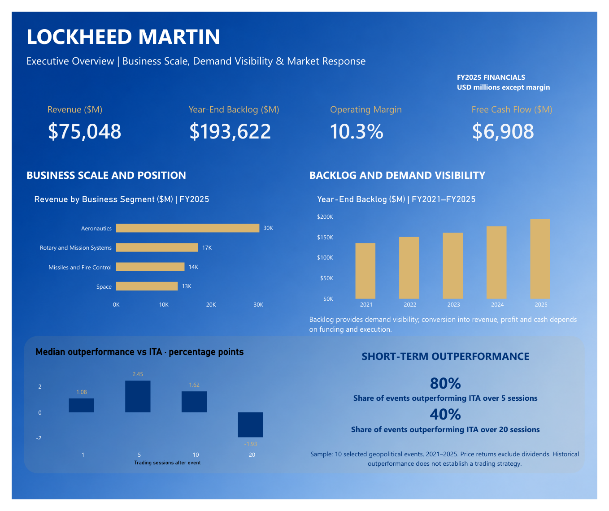

# Lockheed Martin — Geopolitical & Financial Analysis

**Interactive financial research dashboard | Power BI · Financial Statement Analysis · Event Study · Data Visualization**

Independent portfolio project by **Blessing Nwotite**.

[**View the interactive research dashboard ↗**](https://3lessing.github.io/LMT_Geopolitical_Analysis/)  ·  [**Read the original nine-page Power BI report (PDF)**](LMT_Full_Report.pdf)

## Research question

How has Lockheed Martin's financial performance evolved, and how has its share price behaved relative to broad-market and aerospace/defense benchmarks following selected geopolitical events?

This project joins **five years of reported financial performance (FY2021–FY2025)** with **daily LMT, SPY and ITA price histories** and **10 selected geopolitical events (2021–2025)**.

## Interactive dashboard

The GitHub Pages website is a **custom JavaScript recreation** of the Power BI research project, not a native Power BI embed. It uses historical data exported from the project workbooks and works without a Power BI license or sign-in.

| View | What you can explore |
| --- | --- |
| Executive overview | Revenue, backlog, operating margin, free cash flow, and event-window performance |
| Financial performance | Annual revenue, operating profit, net income, and margin trends |
| Geopolitical events | Compare **LMT, SPY, and ITA** returns for 1-, 5-, 10-, and 20-session event windows |
| Reaction persistence | Median excess return, win rate, and an event-by-event heatmap |
| Operating performance | Business-segment revenue, margins, and backlog by year |
| Market performance | Adjust the date range and toggle indexed price series |
| Cash flow analysis | Operations, investing, financing, dividends, repurchases and free cash flow |
| Methodology & sources | Reproduce definitions, review limitations, and open source references |

## Selected findings

- Revenue increased from **$67.0 billion in 2021** to **$75.0 billion in 2025**, while consolidated operating margin fell from approximately **13.6% to 10.3%**.
- FY2025 operating cash flow was **$8.557 billion**, with capital expenditures of **$1.649 billion**, generating approximately **$6.908 billion in free cash flow**.
- In a **selected sample of 10 events**, LMT outperformed aerospace/defense benchmark ITA in **8 of 10 five-session windows**, but only **4 of 10 twenty-session windows**.
- Median LMT excess price return versus ITA shifted from approximately **+2.45 percentage points over 5 sessions** to **−1.93 percentage points over 20 sessions**.

**These observations are descriptive.** They do not establish causation, statistical significance, or a reliable trading strategy. All reported market returns are **price returns excluding dividends**.

## Methodology

- **Return window:** assign the event to the first trading day on or after the event date; use the preceding trading close as the baseline. The assigned session counts as session 1.
- **Security price return:** `(ending close / beginning close) - 1`.
- **Benchmark outperformance:** `LMT price return - benchmark price return`, expressed in percentage points.
- **Operating margin:** `operating profit / revenue`.
- **Free cash flow:** `operating cash flow - capital expenditure`.
- **FCF conversion:** `free cash flow / net income`.
- **Indexed market price:** `current close / first close in selected period × 100`.

Financial and event calculations are consistent with the original Power BI project. Reported source limitations include selected rather than exhaustive geopolitical events, unverified precise announcement times, potentially overlapping windows, dividend exclusions, and missing comparable FY2021 segment operating-profit data.

## Data and references

Lockheed Martin financial data comes from company [2021 full-year](https://news.lockheedmartin.com/2022-01-25-Lockheed-Martin-Reports-Fourth-Quarter-and-Full-Year-2021-Financial-Results), [2023 full-year](https://news.lockheedmartin.com/2024-01-23-Lockheed-Martin-Reports-Fourth-Quarter-and-Full-Year-2023-Financial-Results), and [2025 full-year](https://news.lockheedmartin.com/2026-01-29-Lockheed-Martin-Reports-Fourth-Quarter-and-Full-Year-2025-Financial-Results) earnings releases, including comparative prior years. Historical LMT, SPY, and ITA price observations were sourced from Nasdaq with source-specific corrections noted in the report. Event dates are supported by NATO, United Nations, and Reuters references documented in the event register.

**Data coverage:** financial actuals FY2021–FY2025; market closing-price observations Jan. 2021–Sept. 11, 2026. The website uses a static historical snapshot; it does not make live market-data requests.

## Files

- `index.html` — complete standalone interactive website, including chart code and a copy of the project dataset.
- `LMT_Full_Report.pdf` — original nine-page visual analysis.
- `report-preview.png` — preview of the Power BI report.
- `LMT_Geopolitical_Analysis_final.pbix` — original Power BI file, retained in the GitHub repository if already uploaded.

## Publishing via GitHub Pages

On this repository, go to **Settings → Pages → Build and deployment → Deploy from a branch → `main` → `/(root)` → Save**. GitHub Pages serves the `index.html` file at `https://3lessing.github.io/LMT_Geopolitical_Analysis/` once deployment is complete.

The site is intentionally dependency-free and runs on GitHub Pages or directly in a modern web browser. The `index.html` and report PDF must be uploaded to the **repository root**, not placed inside a subfolder or left zipped.

---

*This is an independent academic/portfolio research project, not affiliated with or endorsed by Lockheed Martin. It is not investment advice.*
